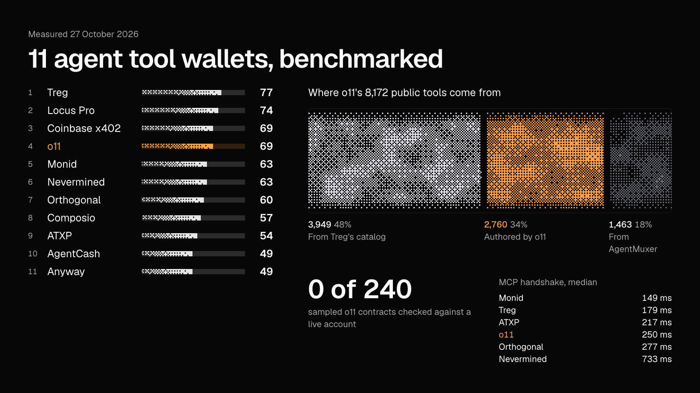

# Agent wallet benchmark

o11, Treg, Monid and eight other agent tool wallets, measured on 27 October 2026.

**Live:** https://arjunkshah12345-hash.github.io/agent-wallet-benchmark/



## What we found

- **Scores, equal weights, out of 100:** Treg 77, Locus Pro 74, Coinbase x402 69, o11 69, Monid 63, Nevermined 63, Orthogonal 60, Composio Instant 57, ATXP 54, AgentCash 49, Anyway 49.
- **o11 has the strongest spend controls:** per-agent cards, tool allowlists, nested budgets, a per-call cost ceiling and approval states.
- **Most of o11's catalog comes from elsewhere:** of 8,172 public contracts, 3,949 (48%) are sourced from Treg's catalog and 1,463 (18%) from AgentMuxer. 0 of 240 sampled contracts had been checked against a live provider account.
- **Countable without an account:** o11 8,172 · Treg 3,548 · Orthogonal 954 · Anyway 193 (10 of 37 providers healthy at fetch) · Coinbase x402 Bazaar 86,533. Monid, Locus Pro, Composio Instant, AgentCash, Nevermined and ATXP have no catalog we could count without signing up.
- **MCP handshake, median:** Monid 149 ms · Treg 179 ms · ATXP 217 ms · o11 250 ms · Orthogonal 277 ms · Nevermined 733 ms.

## Method

- **Catalogs:** downloaded each vendor's public index where one exists. The rest are the vendor's own claims.
- **o11 sample:** 240 contracts drawn at random (seed 42) from `go.o11.ai/v1/tool-reference/index.json` and fetched one by one ([`sample_o11.py`](research/scripts/sample_o11.py)).
- **Speed:** curl from one machine, 12 requests per endpoint, time to first byte ([`latency.sh`](research/scripts/latency.sh), [`targets.tsv`](research/probes/targets.tsv), raw samples in [`latency.tsv`](research/probes/latency.tsv)). One location and one day, so treat gaps under 100 ms as noise.
- **Scores:** judgement against the written reason for each one, in [`lib/bench.ts`](lib/bench.ts). Sources for every vendor are in [`research/vendors`](research/vendors).
- **Not measured:** we made no paid calls and funded no accounts.

Found something wrong or out of date? Open an issue with a link and it will be corrected.

## Run it

```bash
pnpm install
pnpm dev     # http://localhost:3000/agent-wallet-benchmark
pnpm build   # static export to out/
```

Pushing to `main` deploys to GitHub Pages through [`.github/workflows/pages.yml`](.github/workflows/pages.yml). Set `PAGES_BASE_PATH=""` to build for a root domain.

## Where things live

- `lib/bench.ts`: every vendor, score, written reason, feature flag and weighting preset.
- `data/latency.json`: latency medians and 90th percentiles.
- `components/bench/`: the hero catalog field, the leaderboard and the charts.
- `app/card/`: the 1600×900 frame used for the launch image and social preview.
- `research/`: per-vendor notes with sources, raw probe output and scripts.

## Credits

- [dithercn](https://github.com/opencoredev/dithercn) by [@leodev](https://x.com/leodev) (MIT): the dither engine, hero field, progress bars, donut and counters.
- [Dither Kit](https://github.com/Boring-Software-Inc/dither-kit) by Boring Software (MIT): the radar and bar charts.

Code is MIT licensed. Vendor names and trademarks belong to their owners.
